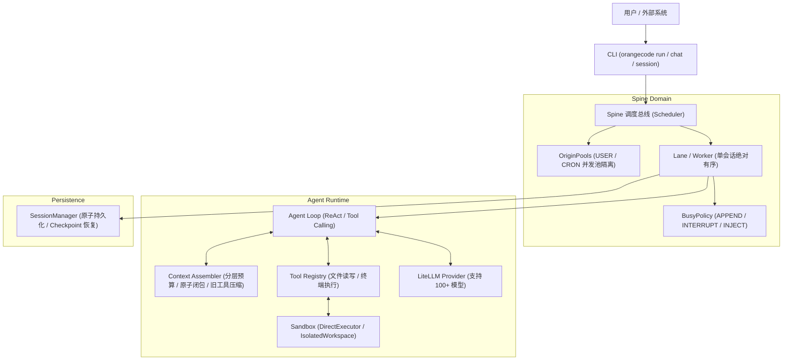

# OrangeCode

> 面向多任务并发与多轮对话的开源 Agent Harness。
> 具备分层上下文治理、会话队列隔离、生命周期打断抢占与安全执行沙箱。

[](https://python.org)
[](LICENSE)
[](tests)

---

## 架构概览



## 核心特性

1. **Spine 调度骨干与并发隔离**：
   - **Lane / Worker 架构**：单会话保证严格串行有序，跨会话支持高并发并行。
   - **OriginPools**：真实用户请求与后台/Cron/Subagent 任务使用独立信号量池，彻底杜绝后台批量任务打满配额导致交互饥饿。
   - **BusyPolicy 抢占**：支持 `INTERRUPT`（打断当前耗时任务插队执行）、`INJECT`（工具轮次间隙合并）与 `APPEND`（队尾排队）。
2. **Context Engine 上下文分级治理**：
   - **原子闭包保护（Canonical Closure）**：计算 `assistant(tool_calls)` 与 `tool(result)` 的传递闭包，杜绝因历史裁剪破坏配对导致的 API 悬空错误。
   - **旧工具输出折叠压缩**：历史轮次产生的超长工具输出（如大文件、大规模日志）自动保留首尾折叠压缩，节省 80%+ 的上下文开销。
   - **BM25 关键词记忆召回**：零外部依赖、支持 CJK 表意字符分词与 Robertson-Spärck-Jones 平滑评分。
3. **安全沙箱（Execution Sandbox）**：
   - `DirectExecutor`：子进程执行、超时自动杀进程。
   - `IsolatedWorkspaceExecutor`：目录越界防御、隔离临时目录与敏感凭据。
4. **多模型统一接入（LiteLLM Provider）**：
   - 统一 OpenAI、Anthropic Claude、DeepSeek、Qwen、Ollama 等供应商接口。
5. **持久化与断点续聊（Session Checkpoints）**：
   - 会话原子写入与持久化快照恢复，支持中断重启。

---

## 快速上手

### 1. 环境准备

本项目使用 [uv](https://github.com/astral-sh/uv) 纳管环境与依赖（要求 Python 3.12+）：

```bash
# 同步安装所有依赖与开发工具
uv sync --extra dev
```

### 2. 命令行体验

#### 查看版本与配置
```bash
uv run orangecode version
```

#### 执行单次复杂任务
```bash
# 使用默认配置（可配置 ORANGECODE_DEFAULT_MODEL 或传入 --model）
uv run orangecode run "请读取当前目录下的 pyproject.toml 文件，并总结其依赖项" --session my-task
```

#### 启动交互式多轮对话 (REPL)
```bash
uv run orangecode chat --session my-conversation
```

#### 管理历史会话与检查点
```bash
# 查看所有已保存会话
uv run orangecode session list

# 查看指定会话的完整历史轨迹
uv run orangecode session show my-conversation

# 删除会话
uv run orangecode session delete my-conversation
```

---

## 自动化测试与代码检查

运行全量测试套件（21 项测试）：
```bash
uv run pytest
```

运行代码静态分析与格式检查：
```bash
uv run ruff check .
```
