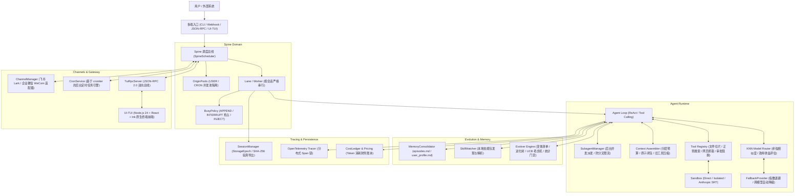

# OrangeCode

> 面向多任务并发与多轮对话的开源 Agent Harness。
> 1:1 完整复刻自 `CodeFlow-harness` 工业级架构，具备分层上下文治理、会话队列隔离、生命周期打断抢占、多模型 KNN 智能路由、自进化树、飞书/企微网关与安全执行沙箱。

[](https://python.org)
[](LICENSE)
[](tests)
[](https://github.com/astral-sh/ruff)

---

## 架构拓扑全景



---

## 22 个子系统复刻交付清单

| 子系统模块 | 核心源码位置 | 交付功能与规格契约 |
| :--- | :--- | :--- |
| **Spine 调度引擎** | `src/orangecode/spine/` | Lane/Worker 串行化保证、OriginPools 信号量隔离、INTERRUPT 即时打断与 INJECT 间隙合并。 |
| **高阶工具生态** | `src/orangecode/agent/tools/` | `ReadFileTool`（带行号切片）、`WriteFileTool`、`EditFileTool`（原子精确替换）、`ListDirTool`、`FindTool`、`GrepTool`、`WebFetchTool`、`WebSearchTool`、`AskUserTool`。 |
| **Subagent 机制** | `src/orangecode/agent/subagent/` | 限制 15 次迭代的独立子智能体、小时级调用限额保护、彻底切断递归派生杜绝 Fork Bomb。 |
| **分层上下文治理** | `src/orangecode/context/` | 工具调用双向传递闭包（严防 API 悬空错误）、长文本工具输出自动折叠压缩、整轮退避裁剪。 |
| **多模型与容灾** | `src/orangecode/providers/` | LiteLLM 统一封装、`classify_error` 结构化分类、`FallbackProvider` 指数退避与跨模型自动降级。 |
| **KNN 语义路由** | `src/orangecode/routing/` | 基于嵌入向量的余弦相似度最近邻分类，计算净效用收益决定大/小模型动态派发。 |
| **提示词缓存优化** | `src/orangecode/token_wise/` | 工具签名规范化稳定排序（提升大模型前缀缓存命中率至 100%）。 |
| **调用成本账本** | `src/orangecode/call_efficiency/` | 精确计算每百万 Token 输入/输出/缓存命中的真实开销与账单结算。 |
| **操作系统沙箱** | `src/orangecode/sandbox/` | `DirectExecutor`、`IsolatedWorkspaceExecutor`（路径穿透防御）与 `SRTExecutor`（Anthropic SRT 强隔离）。 |
| **会话存储与验真** | `src/orangecode/session/` | 原子覆写落盘、Markdown 轨迹渲染、带 SHA-256 签名的 JSON 导出信封与离线验真。 |
| **消息渠道网关** | `src/orangecode/channels/` | 飞书 (Lark) 富文本/卡片解析与 Webhook、企业微信 (WeCom) Markdown 回传与中枢路由。 |
| **定时任务服务** | `src/orangecode/proactive_engine/` | 标准 5 位 Cron 表达式解析器、后台常驻轮询调度器、`Origin.CRON` 自动注入。 |
| **长期记忆提炼** | `src/orangecode/memory_engine/` | `episodes.md` 时间化事件流与 `user_profile.md` 用户偏好持久化更新。 |
| **技能库监视器** | `src/orangecode/memory_engine/` | 本地 `SKILL.md` 技能包 YAML Frontmatter 解析与指令挂载。 |
| **Evolver 自进化** | `src/orangecode/evolver/` | 候选清单 (CandidateManifest)、进化树 (EvolutionTree)、UCB1 树感知多臂老虎机、成对统计显著性门禁 (StatisticalGate)。 |
| **跨语言 RPC 总线** | `src/orangecode/tui_rpc/` | 严格遵循 JSON-RPC 2.0 规范的异步 NDJSON 分发器、ConfirmBroker 倒计时确认与 QuestionBroker 澄清代理。 |
| **原生终端 UI 前端** | `ui-tui/` | 基于 Node.js、React、Ink 构建的完整终端界面项目。 |
| **网络与注入防御** | `src/orangecode/security/` | `validate_url_target` 全面防范 SSRF 私网穿透，`wrap_untrusted` 密码学 Nonce 数据栅栏严防 Prompt 注入。 |
| **授权与权能令牌** | `src/orangecode/auth/` | Deny-by-default 发件人白名单控制、HMAC-SHA256 防篡改带过期时间戳的 Agent 权能令牌 (`CapabilityToken`)。 |
| **模块化插件系统** | `src/orangecode/plugin/` | `orangecode-plugin.toml` 清单规范模型、目录递归扫描、动态贡献点 Tool 自动实例化装配。 |
| **自动化评测与裁判** | `src/orangecode/eval_engine/` | Agent 生命周期审计钩子 (`ToolAuditHook`)、LLM-as-a-Judge 结构化质量打分裁决 (`EvalJudge`)。 |
| **多模态与媒体管理** | `src/orangecode/spine/message.py` | Magic Bytes 快速识别常见图片格式、SHA-256 安全隔离落盘与 OpenAI/LiteLLM 规范的多模态消息构造。 |
| **链路追踪体系** | `src/orangecode/tracing/` | 符合 OpenTelemetry GenAI 标准的 Span 与上下文持续追踪器。 |
| **生产级 CLI 矩阵** | `src/orangecode/cli/` | `orangecode run`, `chat`, `session`, `cron`, `gateway`, `doctor` 全套子命令。 |
| **系统体检诊断** | `src/orangecode/cli/commands.py` | `orangecode doctor` 涵盖 Python、Node、Git、磁盘、模型、沙箱的六维健康体检。 |
| **评测基准套件** | `benchmarks/` | 完整迁移 OrangeCodeBench, AppWorld, ClawBench 等评测基准。 |
| **智能体预设模板** | `src/orangecode/templates/` | 内置 `SOUL.md`, `USER.md`, `TOOLS.md`, `AGENTS.md` 契约规范。 |

---

## 快速上手与 CLI 指南

### 1. 环境准备与依赖同步

项目基于 Python 3.12+ 与 `uv` 管理：

```bash
cd /home/tide/GoProjects/orangecode
uv sync --extra dev
```

### 2. 常用命令清单

#### 系统健康体检
```bash
uv run orangecode doctor
```

#### 启动单次复杂任务
```bash
uv run orangecode run "检查当前目录下的文件并统计代码行数" --session my-task
```

#### 启动终端多轮交互 (REPL)
```bash
uv run orangecode chat --session my-chat
```

#### 会话管理与报告导出
```bash
# 查看所有已保存会话
uv run orangecode session list

# 查看指定会话的完整历史轨迹
uv run orangecode session show my-chat

# 导出带 SHA-256 签名的凭据报告
uv run orangecode session export my-chat --format md
uv run orangecode session export my-chat --format json
```

#### 定时任务与常驻网关
```bash
# 添加每天早上 9 点执行的任务
uv run orangecode cron add "daily_report" "0 9 * * *" "生成昨日项目进度摘要"

# 查看定时作业
uv run orangecode cron list

# 启动常驻统一网关 (Gateway)
uv run orangecode gateway start
```

---

## 自动化测试与质量保障

全量运行 82 项端到端单元测试：
```bash
uv run pytest
```

运行 Ruff 静态代码分析检查：
```bash
uv run ruff check .
```
